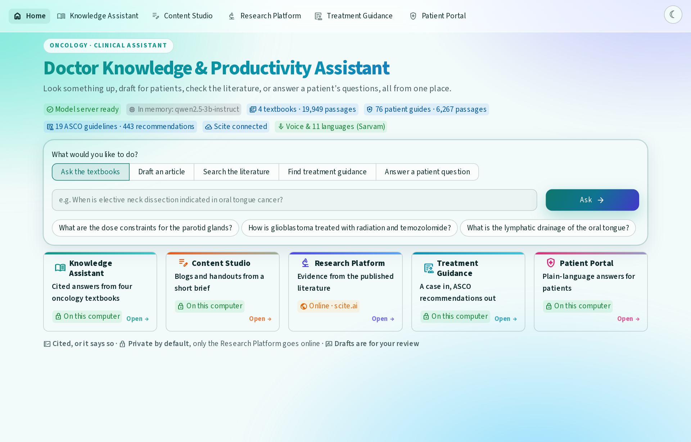
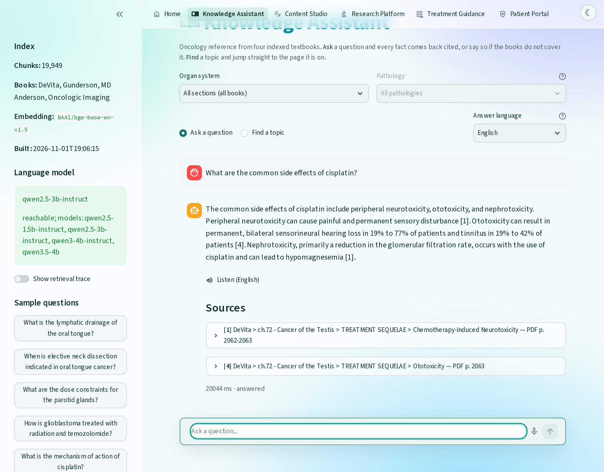
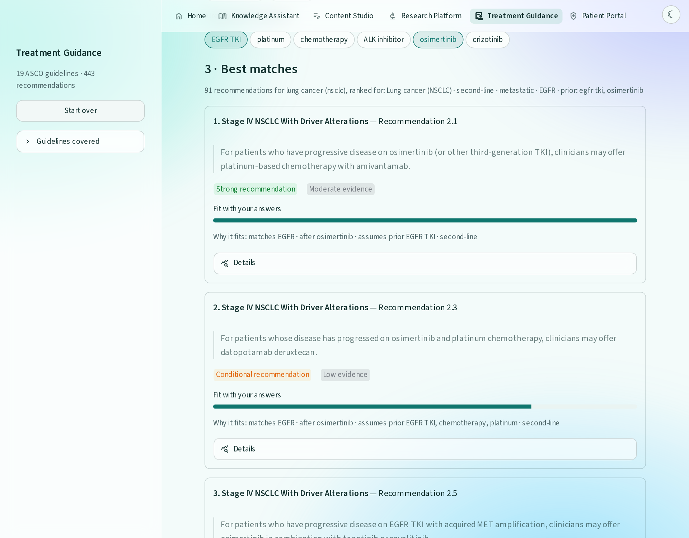
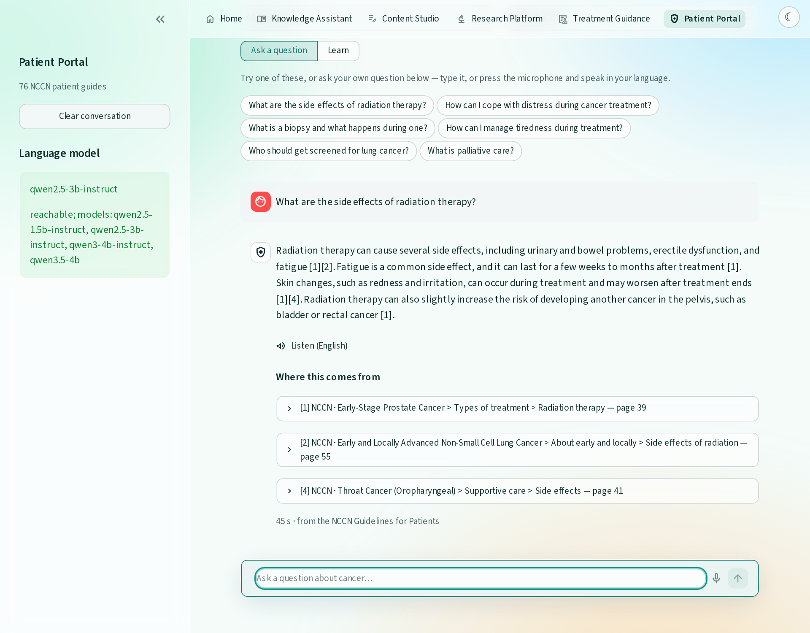
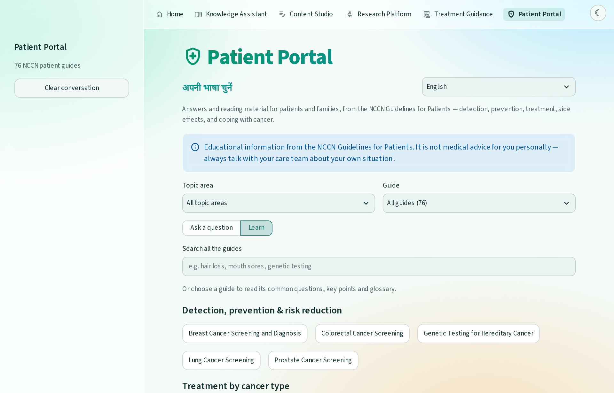
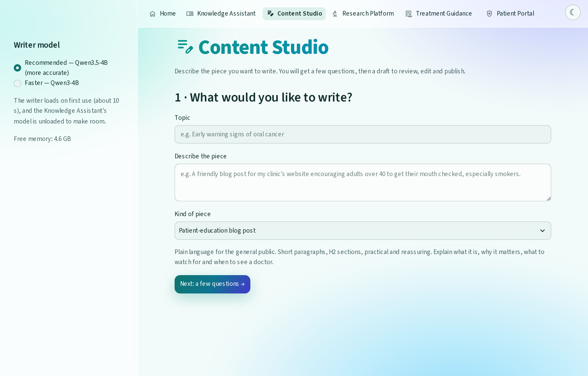
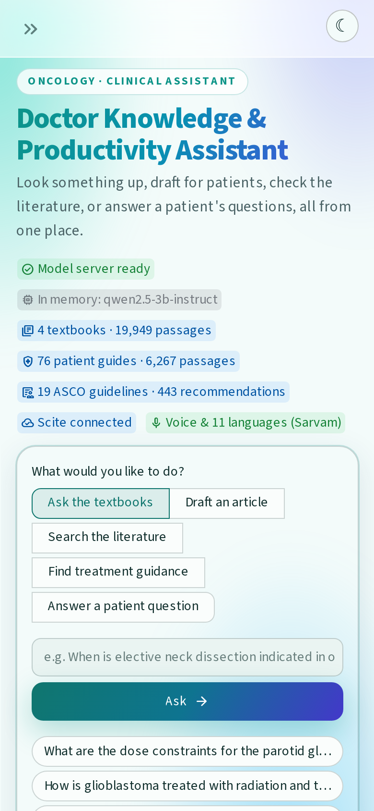
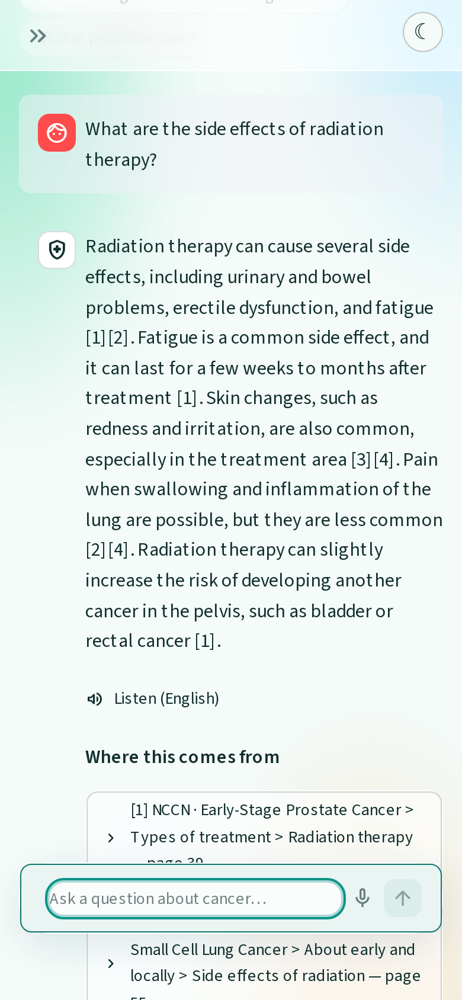
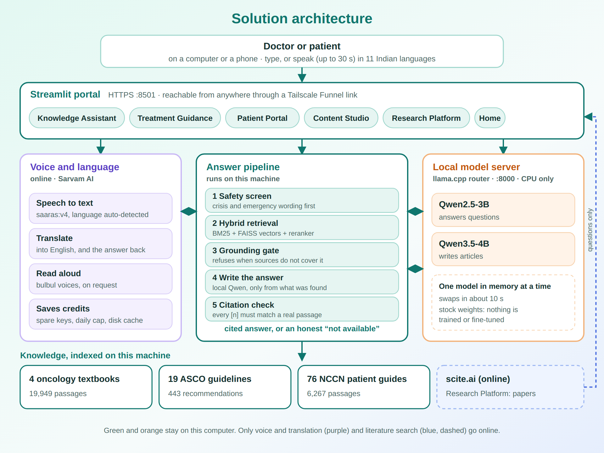

<div align="center">

# 🩺 Doctor Knowledge & Productivity Assistant

### Voice-first oncology answers you can check, for doctors and patients alike.

🎤 **Just speak.** Doctors ask in English or Hindi, patients in any of 11 Indian languages.
Six tools · four textbooks · 19 ASCO guidelines · 76 NCCN patient guides
**One CPU-only machine. No GPU. No training. No uncited claims.**

### 🌐 Try it live: **[v.taila0f4fa.ts.net](https://v.taila0f4fa.ts.net)**

<sub>Served from the project machine through a Tailscale Funnel, so the link works whenever that machine is on.
Voice and the Patient Portal's other-language answers need the machine's Sarvam credit.</sub>

<br>



</div>

**Contents:** [What it does](#what-it-does) · [Architecture](#solution-architecture) · [Quick start](#quick-start) ·
[Configuration](#configuration) · [How it works](#how-it-works) · [Results](#results) ·
[Documentation](#documentation) · [Testing](#testing) · [Privacy](#privacy-what-stays-here-and-what-leaves)

## Why this exists

A doctor in a busy clinic wants an answer with a page number, not a paragraph
that sounds right. A patient wants a plain answer in Tamil or Bengali, not an
English PDF. Chatbots tend to fail both: they sound sure when they are wrong,
and they only speak English.

So this one is built around three promises:

1. **Quote it or say nothing.** Every clinical statement is quoted from, or
   cited to, a named book, guideline or paper, with the page one click away.
   When the sources do not cover a question, the tool says *"not available"*
   instead of guessing. Three separate checks enforce this, and every
   failure we measured was a safe one.
2. **Voice first, for doctors and patients.** A doctor between patients or a patient who
   finds typing hard can just press the microphone and talk. Doctors speak English or
   Hindi (Hinglish is fine) to the Knowledge Assistant; patients speak any of 11 Indian
   languages to the Patient Portal. The answer comes back in the same language *and* in
   English, and can be read aloud. Typing always works too.
3. **Stay on your machine.** The language model is a stock open-weight Qwen
   model run locally. Four of the six tools never send anything off the computer.
   The Research Platform queries scite.ai, and voice and non-English text go to
   Sarvam AI (see [Privacy](#privacy-what-stays-here-and-what-leaves)).

**Nothing is trained or fine-tuned.** All medical knowledge comes from the
indexed sources, which is why every answer can be traced back to one.

## What it does

### 🎤 Voice first: speak, don't type

The microphone is part of the chat box in both question-answering tools, not an add-on.

- **Doctors** speak to the Knowledge Assistant in English or Hindi, including mixed Hindi and English
  medical terms. Drug names, stages and doses stay in English inside Hindi answers.
- **Patients and families** speak to the Patient Portal in any of 11 Indian languages, chosen or
  detected automatically.
- The question is turned into text, shown back to you ("heard in Tamil" with the English version) so a mis-hearing is visible,
  then answered and checked by the same pipeline as a typed one. The answer is read aloud on request.
- Recordings are capped at 30 seconds, and a glowing indicator shows when the microphone is live.

Treatment Guidance, Content Studio and the Research Platform are typed.

### 📚 Ask the textbooks, get an answer you can check

Type a clinical question and every fact in the answer carries a marker that opens the book, chapter and
page it came from. The answer is built only from passages the search actually found, and every marker is
checked against them before you see it. If the four textbooks (DeVita, Gunderson, MD Anderson, Oncologic
Imaging) don't cover the question, you get "not available" instead of a guess. A second mode, *Find a
topic*, lists where a subject is discussed, book by book and page by page, with no model involved.



### 🧭 Describe a case, see the guideline recommendations that fit

Write the case in a sentence ("Stage IV NSCLC with EGFR L858R, progressed on osimertinib") or pick a cancer
and answer two or three questions. The tool reads the case, then ranks the matching recommendations from 19
ASCO guidelines, showing each one's strength, evidence quality and why it fits. Recommendations and trial
figures are quoted from the guideline, never generated. When the guidelines have nothing for the case, it
searches the textbooks and labels the answer as coming from the books.



### 🩺 A patient portal that speaks the patient's language

Patients and families ask in plain words, by voice or typing, in any of 11 Indian languages. The question is
translated to English and answered from the 76 NCCN Guidelines for Patients, and the reply comes back in the
patient's language and in English, with a Listen button. A safety screen runs first, so wording that points to
a crisis or an emergency gets a safe response before any answer. The recording is capped at 30 seconds, and a
glowing indicator shows when the microphone is live.



### 📖 Learn mode: read the guides, not just ask

Pick any of the 76 guides to read its common questions, key points, questions to ask your doctor, and a glossary.
The search box accepts words in any supported language and translates them first, so a word typed in Bengali
still finds the right guide.



### ✍️ Content Studio: from a short brief to a draft

Describe the piece you want, answer a few clarifying questions, and get a draft blog post or patient handout
to review, edit and publish. It uses a separate writer model, which is swapped in only while you use it.



### 🧪 Research Platform and a home page that gets you started

The Research Platform sends a question to scite.ai, then summarises the returned papers locally with numbered
citations. A de-identification guardrail anonymises patient details (name, age, address, dates, IDs) in
the question, and in the answer that comes back, before anything leaves the machine. The home page has a launcher: pick a task, type or choose an example, and you land in that tool with
the work already started.

### 📱 Built for phones too

The top bar folds into a menu, the launcher and status badges reflow to the screen width, and the microphone sits
right in the chat box, so a patient can ask by voice from a phone browser.

<p align="center">

&nbsp;&nbsp;&nbsp;

</p>

<sub>Screenshots show the light theme, which is the default; a sun/moon button at top right switches to dark.
They were captured against the running app with the voice service mocked, so no credits were spent.</sub>

## Solution architecture



1. **The portal.** A Streamlit app serves all six tools over HTTPS. The same page works on a desktop and a phone,
   and a Tailscale Funnel gives it a public address.
2. **Voice and language (online).** Speech is transcribed, translated to English, and the answer is translated
   back and read aloud by Sarvam AI. Spare keys, a daily spending cap and a disk cache keep the credit use small.
3. **The answer pipeline (local).** The question first goes through a safety screen. A hybrid search (keyword and
   vector, then a reranker) finds passages in the indexed sources. A grounding gate refuses to answer if the
   passages don't cover the question. The model then writes only from what was found, and a citation check
   verifies every `[n]` marker before anything is shown.
4. **The model server (local).** llama.cpp serves stock Qwen weights on the CPU, one model in memory at a time:
   a 3B model for questions and a 4B model for writing. Nothing is trained or fine-tuned.
5. **The knowledge.** Four textbooks (19,949 passages), 19 ASCO guidelines (443 recommendations) and 76 NCCN
   patient guides (6,267 passages) are indexed on the machine. Only the Research Platform's questions go to scite.ai.

More detail is in **[docs/architecture.md](docs/architecture.md)** and **[docs/product.txt](docs/product.txt)**.

## The tools

The portal opens on a **home page** with a navigation bar across the top
(Home · Knowledge Assistant · Content Studio · Research Platform · Treatment
Guidance · Patient Portal) that stays on every page. It is light by default; a
sun/moon button at top right switches to dark and remembers the choice. The
home page has:

- a **launcher** — pick *Ask the textbooks*, *Draft an article* or *Search the
  literature*, type (or pick an example), and you land in that tool mid-task:
  the question already asked, the article topic already filled in, or the
  literature search already sent;
- a short **card per tool** saying what it does and whether it runs on this computer
  or online; the whole card is the link into the tool, and the page fits one screen;
- **live status** — whether the model server is up, which model is in memory,
  the size of the textbook and patient-guide indexes, and whether Scite is
  configured.

| tool | what it does |
|---|---|
| 🔬 **Knowledge Assistant** | cited answers from four oncology textbooks, with refusals when the books do not cover the question (the rest of this README) |
| ✍️ **Content Studio** | drafts a blog post, patient handout or article from a short brief and a few questions — see **[docs/content-studio.md](docs/content-studio.md)** |
| 🧪 **Research Platform** | literature-grounded answers from published papers via [Scite](https://scite.ai), summarised locally — see [below](#research-platform-scite) |
| 🧭 **Treatment Guidance** | for clinicians: type a case or pick a cancer, answer 2–3 questions, get the ranked matching recommendations from 19 *ASCO guidelines* (and, when they have nothing, a cited answer from the textbooks, labelled as such) with their strength, evidence quality and the trial figures the guideline prints — quoted, never generated — see [below](#treatment-guidance) and **[docs/treatment-guidance.md](docs/treatment-guidance.md)** |
| 🩺 **Patient Portal** | for patients and families: plain-language, cited answers from the 76 *NCCN Guidelines for Patients*, plus each guide's own FAQs, key points, questions to ask and glossary — see [below](#patient-portal) and **[docs/patient-portal.md](docs/patient-portal.md)** |

🎤 **Voice and languages.** The Patient Portal and the Knowledge Assistant take
questions by **voice or typing**. Patients can use any of 11 Indian languages
(detected automatically, or picked), and doctors English or Hindi. The question
is translated to English, answered and checked by the unchanged pipeline, and
the answer comes back **in that language and in English**, with a Listen
button. This uses [Sarvam AI](https://docs.sarvam.ai) and needs
`SARVAM_API_KEY` — see [below](#voice-and-languages) and
**[docs/voice.md](docs/voice.md)**.

The Knowledge Assistant and the Content Studio use different language models
but share **one model server that holds one model at a time**, swapping on
demand (~10 s into the writer, ~4 s back). Neither tool's model sits in memory
while the other is in use.

---

## Knowledge Assistant

A retrieval-augmented question-answering platform over two clinical oncology
textbooks, built to run entirely on a CPU. Ask a question in plain English and
every fact in the answer comes back with the book, chapter and page it came
from — and the page itself is one click away. When the books do not answer the
question, it says so instead of guessing.

Two modes over the same index:

- **Ask** — a question gets a cited answer, or an honest refusal.
- **Find** — a topic gets a list of *where it is discussed*, book by book and
  page by page, with no model involved. Instant, and it cannot invent a
  reference.

Filter either mode to a single organ system or pathology ("Head & Neck → Oral
cavity & tongue") with the two selectors above the question box.

---

## What is in this repository, and what is not

**Not included, and gitignored:** the source PDFs (`data/`, `sources/`), the
extracted corpus, the built indexes and voice cache (`artifacts/`), the model
weights, logs, local certificates and `.env`. The books are copyrighted and are not
redistributed here — neither are the ~20 million characters of text extracted
from them. You supply your own copies.

**Included:** all the code, configuration, the organ-system taxonomy, the
evaluation sets and the documentation. Everything needed to rebuild the index
from your own PDFs.

| you supply | the pipeline builds |
|---|---|
| `data/*.pdf` (2 books, ~350 MB) | `corpus/` — cleaned, sectioned text |
| | `artifacts/index/` — FAISS + BM25 + taxonomy |
| | `models/` — llama.cpp binary + GGUF weights (downloaded, ~7.7 GB) |

---

## Requirements

- Linux x86-64, Python 3.12
- ~8 GB RAM, ~12 GB free disk (7.7 GB models, 2 GB venv, ~0.9 GB corpus + index).
  Only the 3B reference model and one writer are required; the two optional
  models (1.5B reference, Qwen3-4B writer) can be dropped from
  `scripts/00_fetch_models.sh` to save ~3.3 GB.
- **No GPU and no C toolchain required.** The generator is a prebuilt
  llama.cpp binary, because this machine has neither.

The four books it is built on:

- *DeVita, Hellman & Rosenberg's Cancer: Principles & Practice of Oncology*, 11th ed. (4,360 pp)
- *Gunderson & Tepper's Clinical Radiation Oncology* (2,300 pp)
- *The MD Anderson Surgical Oncology Handbook* (1,160 pp)
- *Oncologic Imaging: A Multidisciplinary Approach* (865 pp)

Place them in `data/` and set their filenames and page counts in
`config/books.yaml`. Other books will work, but the chapter/page-window
settings in that file are specific to these editions.

---

## Quick start

```bash
python3 -m venv .venv && source .venv/bin/activate
pip install -r requirements.txt

# put your two PDFs in data/, then:
bash scripts/run_all.sh     # models + PDFs -> corpus -> chunks -> index -> calibration

./start                     # https://localhost:8501, and https://<this machine's IP>:8501 on the LAN
```

The portal is served over **HTTPS** with a self-signed certificate that
`./start` makes in `certs/` (covering `localhost` and the machine's LAN
addresses, and remade when the address changes), because browsers only
allow the microphone on a secure page. The browser warns once about the
certificate: *Advanced → Proceed*. `./start --http` serves plain http
instead, with the microphone working only on `localhost`.

`run_all.sh` downloads the models in one lane while the data pipeline runs in
another. Budget about **90 minutes** end to end on a 6-core CPU, almost all of
it embedding 19,949 chunks; everything else is minutes. Stage 3 reuses the
vectors of any chunk already in the index, so adding a book only embeds that
book's chunks (about 23 min for the two newest, 4,105 chunks); pass
`--no-reuse` to re-embed everything.

```bash
./start                  # model server + portal (home page, all tools)
./start --model 1.5b     # smaller, ~2x faster generator (it transcribes; see docs)
./start --no-llm         # retrieval and topic lookup only, no model needed
./stop                   # stop everything from any terminal
./stop --status          # what is running, and which ports are held
```

The portal opens on the home page; every tool is one click away in the
navigation bar at the top (`/knowledge`, `/studio`, `/research`). Each tool
keeps the left sidebar for its own settings.

`./start` runs both services as children of that terminal — close it, or press
Ctrl+C, and both stop. `./stop` is for when that did not happen: a run killed
with `-9`, or backgrounded and forgotten, which shows up as `./start` refusing
to boot because port 8000 is held.

---

## Configuration

Secrets and machine settings live in `.env` (gitignored; copy
`.env.example`). Everything else is in `config/`.

| setting | where | what it does |
|---|---|---|
| `SCITE_API_KEY`, `extra_scite_api` | `.env` | Research Platform's Assistant API; the extra key is used when the first is over its monthly limit |
| `SCITE_MCP_API_KEY` | `.env` | Research Platform's literature-search fallback (then `extra_scite_api`) |
| `SARVAM_API_KEY_coiffeur`, `SARVAM_API_KEY`, `SARVAM_API_KEY_1`, `SARVAM_API_KEY_2` | `.env` | voice and languages; tried in that order, and a key that is out of credit is skipped from then on |
| `LLM_BASE_URL`, `LLM_MODEL` | `.env` | point the platform at a different OpenAI-compatible model server |
| `SARVAM_MOCK=1` | environment | offline fake Sarvam, for tests; spends nothing |
| `config/rag.yaml` | repo | models, retrieval thresholds, refusal messages |
| `config/voice.yaml` | repo | Sarvam models and voices, languages, daily rupee cap (₹500), 30 s recording limit, prices |
| `config/models.ini` | repo | model-server presets (which GGUF, context size) |
| `.streamlit/config.toml` | repo | the light theme (see `app/ui_theme.py` for the aurora/glass look) |

Keys that fail for credit or quota reasons are remembered in
`artifacts/key_state.json` (a fingerprint, never the key); delete that file to
try them again. Spend on Sarvam is estimated into `sarvam_api_usage.txt`.

---

## How it works

```
your question
     |
     v
  [1] topic gate .......... is this a question these books could answer?
     |                      cheap, no model call
     v
  hybrid retrieval ........ dense (FAISS) + BM25, fused with RRF,
     |                      then cross-encoder reranked
     v
  [2] grounding gate ...... did anything retrieved actually clear the bar?
     |                      refuses before spending an LLM call
     v
  generation .............. Qwen2.5-3B, 4-bit, on CPU via llama.cpp
     |                      answer must cite every sentence
     v
  [3] citation check ...... is the answer really tied to those sources?
     |
     v
  cited answer, or "the answer is not available in the provided sources"
```

**The refusal guarantee.** "Say when you don't know" cannot rest on a prompt,
so it is enforced at three independent points. Any one of them can refuse, and
the first two never spend an LLM call. Layer 3 is what makes it independent of
the model's goodwill: an uncited or unverifiable answer is replaced with the
refusal, and the user never sees it.

The full technical picture — data, preprocessing, indexing, retrieval and the
query path end to end — is in **[docs/architecture.md](docs/architecture.md)**.
Why the guarantee is built this way, and what changed when the corpus widened
from tongue cancer to both whole books, is in
**[docs/design.md](docs/design.md)**.

---

## Results

Measured on an AMD Ryzen 5 5600G (6 cores, no GPU). Full numbers and method in
**[docs/measurements.md](docs/measurements.md)**.

| | |
|---|---|
| Retrieval Recall@5 | **96%** (24/25 labelled questions) |
| Retrieval latency | **~0.9 s** per question |
| Correct organ system in top-5 | **38/38** across all 14 systems |
| Answer latency | ~34 s, first words on screen at ~10 s |

End to end with all three refusal layers live, over 67 labelled questions:

| bucket | required behaviour | result |
|---|---|---|
| 25 answerable (precise) | answer, with citations | **23** |
| 12 answerable (broad phrasing) | answer, with citations | **9** |
| 12 in-scope, non-tongue | must not be refused as off-scope | **12/12** |
| 8 unanswerable | abstain | **8/8** |
| 10 off-topic | refuse | **10/10** |

Every shortfall is a *safe* failure: the platform said "not available" where it
could have answered, never the reverse.

### Clinical question set

77 open-ended, multi-part clinical questions (`test/Questions .docx`) —
head & neck, lung, breast, CNS, GI, GU, gynaecological, sarcoma, lymphoma,
paediatric, palliative, radiobiology and evidence interpretation — run through
the full pipeline with Qwen3.5-4B as the generator:

| result | count |
|---|---|
| answered from the books, with references | **65** |
| "Not in book" — refused before generation (grounding gate) | 8 |
| "Not in book" — answer failed the citation check | 4 |

About 97 minutes for all 77 on this CPU (60–130 s per answered question). The
per-question sheet — question, response, in book or not, references — is
`test/questions_results.xlsx`. Several of the 8 early refusals are questions the
books do cover, phrased as long case vignettes; the reranker and its threshold
were calibrated on short questions, so this is the platform's main known
weakness on this style of question.

```bash
python scripts/eval_questions.py               # resumable; checkpoints each answer
python scripts/eval_questions.py --build-only  # rebuild the sheet, no model calls
```

---

## Documentation

| | |
|---|---|
| **[docs/architecture.md](docs/architecture.md)** | **start here** — data, preprocessing, indexing, retrieval, and the full query path |
| **[docs/content-studio.md](docs/content-studio.md)** | the article writer: flow, one-model-at-a-time memory design, writer model benchmarks |
| **[docs/patient-portal.md](docs/patient-portal.md)** | the patient tool: how the NCCN guides are parsed, the second index, safety screen, patient prompt, results |
| **[docs/voice.md](docs/voice.md)** | voice input and Indian languages: the flow, keeping citations through translation, model choices, credits, results |
| **[docs/treatment-guidance.md](docs/treatment-guidance.md)** | the clinician tool: ASCO recommendation parsing, the case reader, ranking rules, results and limits |
| **[docs/design.md](docs/design.md)** | the three refusal layers, scope decisions, streaming, answer length |
| **[docs/pipeline.md](docs/pipeline.md)** | the six build stages, parallelism, corpus modes, organ-system tagging |
| **[docs/measurements.md](docs/measurements.md)** | every measured number — including the optimisations that were tried and rejected |
| **[docs/operating.md](docs/operating.md)** | testing without a GPU, tuning notes |
| **[docs/cancer-classes.md](docs/cancer-classes.md)** | every malignancy the books cover, by tissue of origin and by organ system |
| **[docs/product.txt](docs/product.txt)** | the product summary: what each tool is for, results, and what is next |

---

## Research Platform (Scite)

The Research Platform page (`app/views/research_platform.py`) answers research
questions from the published literature through [Scite](https://scite.ai).

1. The question — with the conversation so far — goes to the **Scite
   Assistant API** (`SCITE_API_KEY`): `POST /api_partner/assistant/poll`
   returns a task id, polled at `GET /api_partner/assistant/tasks/{id}` until
   it succeeds or `SCITE_TIMEOUT_SECONDS` passes.
2. If that fails — no key, or the plan's monthly limit is used up (HTTP 429) —
   it falls back to Scite's **MCP literature search** (`SCITE_MCP_API_KEY`,
   `search_literature` over JSON-RPC at `/mcp`), which returns papers but no
   written answer.
3. The abstracts and evidence excerpts of the returned papers are summarised
   by the **local reference model** (map-reduce over ~12k-character batches),
   citing each paper as `[n]`. If the model server is down, Scite's own output
   is shown instead. The evidence sent to the model is logged to
   `logs/scite/evidence-*.jsonl`.

Each source card shows authors, journal, year, a DOI link, the abstract and
the excerpts. The sidebar sets answer length, citation style, and whether to
use references.

**Setup** — put the keys in `.env` (gitignored; see `.env.example`):

```bash
SCITE_API_KEY=...            # Assistant API (needs the `assistant` scope)
SCITE_MCP_API_KEY=...        # optional fallback: literature search
extra_scite_api=...          # optional spare key, used when the first is over its monthly limit
SCITE_API_BASE_URL=https://api.scite.ai
SCITE_TIMEOUT_SECONDS=120
SCITE_POLL_INTERVAL_SECONDS=1
```

**Spare keys.** Keys are tried in order (`rag/keyring.py`): the Assistant API
uses `SCITE_API_KEY` then `extra_scite_api`; the literature-search fallback uses
`SCITE_MCP_API_KEY` then `extra_scite_api`. A key that answers HTTP 429 (monthly
limit) is skipped until the 1st of next month, so no request is wasted on it.
Both Scite plans share one monthly limit per account, so a second key helps only
if it belongs to a different plan.

**Timing:** ~3 s for the search, then ~2 minutes for the local summary of ten
papers on this CPU. **Privacy:** unlike the other tools, the question text
is sent to scite.ai, but only after `rag/deid.py` has anonymised patient details: names become `[NAME]`,
addresses `[ADDRESS]`, dates `[DATE]`, and an age is generalised to a decade
("54-year-old" becomes `[AGE 50s]`, so the clinical picture survives; "aged 18-65" and "over 65"
are left alone). Phone, Aadhaar, ID and email patterns are removed as well. It runs in the client that builds the request, on the
question, the earlier chat turns and the returned answer; a question made only of
identifiers is refused, not sent; the page tells the user what was removed. It is
pattern-based, so it cannot catch a bare name with no title or cue ("Ramesh has stage
III cancer") or a place name, and it cannot be turned off. Do not type patient
details into research questions regardless.

---

## Patient Portal

The Patient Portal (`app/views/patient_portal.py`) is for **patients and
families**, not clinicians. It is built only on the **NCCN Guidelines for
Patients** — 76 guides in four topic areas: detection, prevention and risk
reduction; treatment by cancer type; supportive care (distress, fatigue,
nausea, blood clots, palliative care, survivorship…); and specific
populations (adolescents and young adults, older adults, caregivers). Two
selectors above the content narrow it to a topic area and a guide.

- **Ask** — a question in everyday words gets a plain-language answer from the
  guides, every sentence cited, with the guide page one click away. It is the
  Knowledge Assistant's pipeline — same three refusal layers, same models —
  on a **separate index**, so a patient answer can never cite a textbook. A
  **safety screen** runs first: crisis language gets a helpline message and
  no generated answer; urgent symptoms get a "contact your care team now"
  notice above the answer; "should I stop my treatment?" is answered in
  general terms with the decision left to the care team. When the 3B model
  cannot produce a checked answer (it abstains, drops its citations, or the
  model server is slow) but retrieval found strong evidence, the guides' own
  top passages are shown, cited, instead of "not available". Everyday words
  ("tired") are matched to the guides' terms ("cancer-related fatigue") for
  searching.
- **Learn** — each guide's *own* reading material, unchanged: its common
  questions, key-point summaries, questions to ask your doctor (downloadable as
  a checklist) and glossary, plus a search across all 76 guides. No language
  model is involved, so it is instant and exactly what NCCN wrote.

**Build** (once; the guides go in `data/nccn/`, gitignored like the books):

```bash
python scripts/07_build_patient_corpus.py   # 76 guides -> sections, library, chunks (~20 s, 12 workers)
python scripts/03_build_index.py --chunks corpus/patient/chunks.jsonl --out-dir artifacts/index_patient
python scripts/08_eval_patient.py           # Recall@5, gates, safety routing, threshold
```

Measured: retrieval Recall@5 **100%** (35/35 labelled patient questions),
off-topic refused **8/8**, not-covered refused **6/6**, no answerable question
refused, safety routing **12/12**. Details in
[docs/patient-portal.md](docs/patient-portal.md#results).

---

## Voice and languages

Both chat tools have a **microphone in the question box** and a **language
selector**. Both start in English, and typed English never calls Sarvam.

- **Patient Portal:** at the top of the page, "Choose your language" cycles
  through all 11 languages beside the selector: English, Hindi, Bengali,
  Gujarati, Kannada, Malayalam, Marathi, Odia, Punjabi, Tamil and Telugu, or
  Auto-detect. Answers are in plain native script, followed by the English.
  The page's buttons and labels follow too: English alone by default, English
  with the chosen language beneath it otherwise.
- **Knowledge Assistant:** English or Hindi. Hindi answers are code-mixed, so
  drug names, doses and staging stay in English.

How it works:

1. A spoken question is transcribed by Sarvam (`saaras:v4`), which also
   identifies the language. A typed question's language comes from its script,
   and the language-ID API is used only for Devanagari and Latin text.
2. The question is translated to English and goes through the **unchanged**
   pipeline: safety screen, retrieval, the three refusal layers and the
   citation check. A crisis message typed in Hindi is caught exactly like the
   English one.
3. Only the checked English answer is translated back, with every `[n]`
   citation kept on the sentence it cites.
4. **Listen** reads it aloud (`bulbul:v4-flash`). Audio is made only when
   pressed.

To set it up, add `SARVAM_API_KEY=` to `.env`. Without it, both pages behave
as before (typed English only). Spare keys are optional: `SARVAM_API_KEY_coiffeur`,
`SARVAM_API_KEY`, `SARVAM_API_KEY_1`, `SARVAM_API_KEY_2` are tried in that
order, and a key refused for credit (HTTP 402, or a 429 that names credit or quota)
is skipped from then on, across restarts (`artifacts/key_state.json`; delete it to
try the keys again).

**Recording.** While the microphone records, the question box glows red and a bar
shows a pulsing dot and moving bars; "Recording sent" or "Recording cancelled"
shows when it ends. A recording is capped at **30 seconds**
(`limits.max_record_seconds` in `config/voice.yaml`) because speech to text is
billed per second: the page presses send at the limit, and the server refuses a
longer recording before making any request. Nothing counts down on screen.

**Learn search.** In the Patient Portal's Learn tab, a search or glossary lookup
typed in another script is translated to English once (then cached) so the English
guides can be searched, and the page shows "Searching for: …".

Credits are kept low:

- every translation and audio clip is cached on disk and shared by all users,
  including the fixed "I couldn't find an answer in the NCCN Guidelines" messages,
  which are translated and voiced once per language and then free;
- 9 of the 11 languages are detected for free;
- nothing is translated or spoken until shown or asked for;
- a daily budget in `config/voice.yaml` (₹500 a day, across all keys) stops further
  calls once reached, while cached results and English keep working;
- every call is written to `sarvam_api_usage.txt` (total spent, spend per service,
  every transaction with the key used); nothing about spend is shown in the web app;
- the tests run against an offline mock. The one live check is:

```bash
python scripts/11_voice_check.py   # speak → transcribe → translate → answer → translate back (~₹0.6, ₹0 on rerun)
```

The microphone works on any device on the network, since `./start` serves HTTPS. Model
choices, measurements, costs and limits are in **[docs/voice.md](docs/voice.md)**.

---

## Treatment Guidance

Treatment Guidance (`app/views/treatment_guidance.py`, at `/guidance`) is for
**clinicians**. A doctor describes a case in a text box (or taps an example),
or just picks a cancer and answers two or three optional questions, and sees the
best-fitting recommendations from **19 ASCO guidelines**, ranked and re-ranked
after every answer: lung
(with and without driver alterations), breast, ovarian, myeloma, melanoma,
thyroid, gastroesophageal, biliary, prostate (mCRPC), glioma, GEP-NET, plus
cross-cutting guidelines (ctDNA testing, growth factors, cancer in pregnancy,
communication).

- **Describe or pick, answer, see.** Type a case, or tap one of six checked
  examples, or tap a cancer; the questions that follow
  (the situation, then the one or two facets that most of that cancer's
  recommendations depend on: biomarkers, PD-L1, histology, prior drugs) are
  chosen from the data, and each is optional. The top three appear at once
  and re-rank after every answer. Rules (no model) read typed text and answer
  the questions for you. The page lists the covered cancers, and one it does
  not cover is flagged, never searched as another.
- **Ranked with reasons.** Each recommendation is scored on agreement with
  the case, with hard exclusions on contradiction (a HER2-negative regimen
  for a HER2-positive case, a "not previously received X" recommendation
  when X was given), then ordered by strength and evidence quality. Every
  card says why it matched.
- **When the guidelines have nothing, the textbooks.** If the text names a cancer
  none of the 19 guidelines cover, or no recommendation matches the answers, the
  page asks the oncology textbooks the same question through the Knowledge
  Assistant's pipeline and shows the answer under **From the textbooks**, with a
  notice that it is *not from the ASCO guidelines*, its sources by book, chapter
  and page, and a button that opens the question in the Knowledge Assistant. If the
  books do not cover it either, it says so. A covered case never calls the model.
- **Quoted, not generated.** Each card shows the recommendation verbatim,
  its strength, evidence quality and guideline version, the guideline's own
  trial statistics with the figures in bold, and the PDF page. A test checks
  that all 1,264 statements and statistics appear word for word in their PDF.

**Build** (seconds, no model; the PDFs go in `data/asco/`, gitignored):

```bash
python scripts/09_build_asco.py     # 443 recommendations, 821 statistic sentences, ~1 s
python scripts/10_eval_guidance.py  # matching, case reading, verbatim check
```

Measured: on 10 new cases scored once, untouched, the expected recommendation
was in the top 3 for **5/10** — the honest estimate for unseen cases. The
misses were fixed and folded into the tuning set (35/35 there). Details and
limits in [docs/treatment-guidance.md](docs/treatment-guidance.md).

---

## Testing

```bash
python scripts/smoke_test.py        # 124 checks: guards, citations, scoping, PDF rendering, Patient Portal, Treatment Guidance, voice & languages (mock)
python scripts/ui_test.py --no-llm  # 95 checks: clicks the real UI via Streamlit AppTest, no model needed
python scripts/ui_test.py           # adds a real answer, a real draft and a live Scite query (~5 min)
python scripts/04_evaluate.py       # Recall@k, refusal accuracy, threshold calibration
python scripts/06_eval_coverage.py  # retrieval coverage across all 14 organ systems
python scripts/ask_batch.py --locate  # all 100 example queries (eval/queries.txt), no model needed
```

`smoke_test.py` runs the whole stack against a stubbed model server, so the
plumbing — including all three refusal layers — can be verified without a GPU
or even a generator. `ui_test.py` exists because pipeline tests cannot catch
interaction bugs: it was written after a "Go to section" button rendered its
page correctly and then hid it inside a container that snapped shut. It
covers the home page (including the launcher handing a topic to the Content
Studio), both Knowledge Assistant modes, the Content Studio, the Research
Platform, Treatment Guidance, the Patient Portal, and questions in Hindi and
Tamil (against the offline Sarvam mock, so no credits are spent).

---

## Privacy: what stays here and what leaves

| | stays on this computer | sent to a service |
|---|---|---|
| Knowledge Assistant (English), Content Studio, Treatment Guidance, Patient Portal (English) | everything: the sources, indexes, models, questions and answers | nothing |
| Research Platform | the local summary, and every identifier (removed by `rag/deid.py`) | the de-identified question and conversation, to scite.ai |
| Voice and languages | the checked English answer, retrieval, safety screening | a recording, or text in another language, or text being translated or read aloud, to Sarvam AI |

A typed English question in English mode never leaves the computer. The source
PDFs, the text extracted from them, the indexes, the models, the API keys, the
usage report and the logs are all gitignored.

## Clone the repository

```bash
git clone https://github.com/viren711/healthathon.git
cd healthathon

python3 -m venv .venv && source .venv/bin/activate
pip install -r requirements.txt

cp .env.example .env     # then add your own SCITE_API_KEY and SARVAM_API_KEY
```

The textbooks, guideline PDFs, indexes and model weights are not in the repository
(see [What is in this repository, and what is not](#what-is-in-this-repository-and-what-is-not)).
Put your own PDFs in `data/` and build the index as described in [Quick start](#quick-start), then run `./start`.
